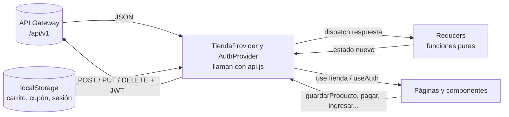
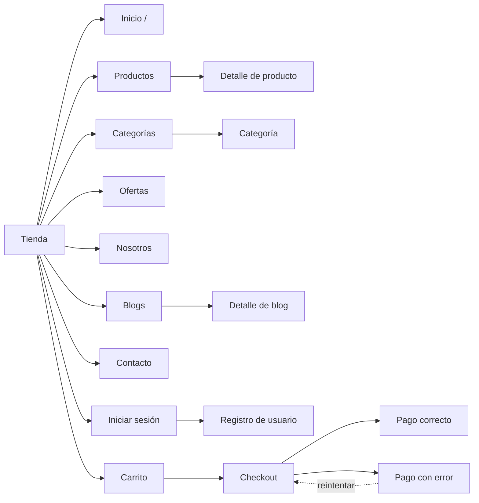
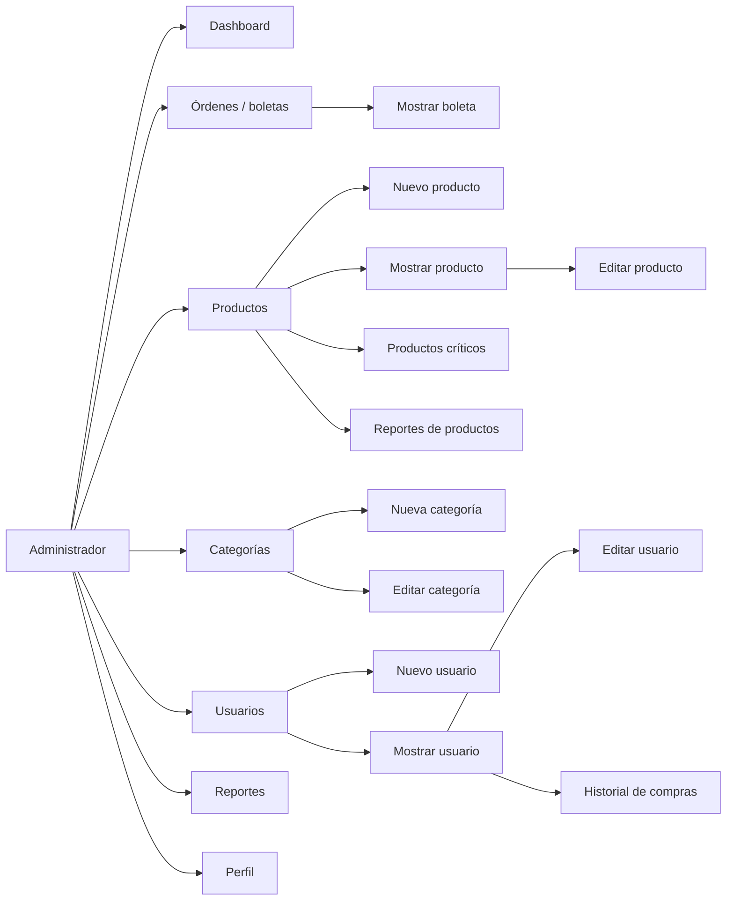
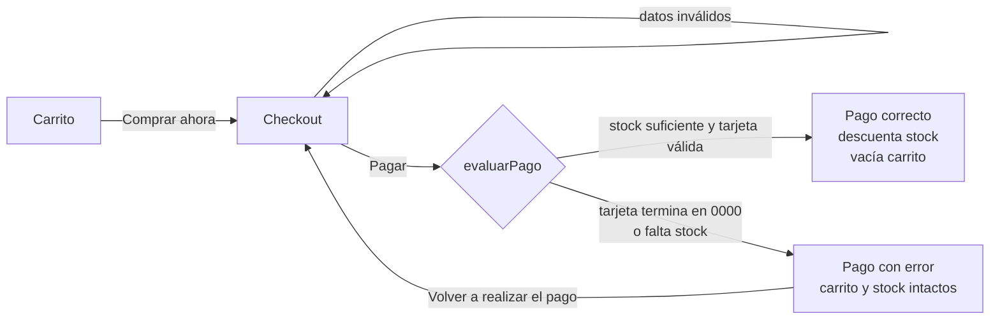
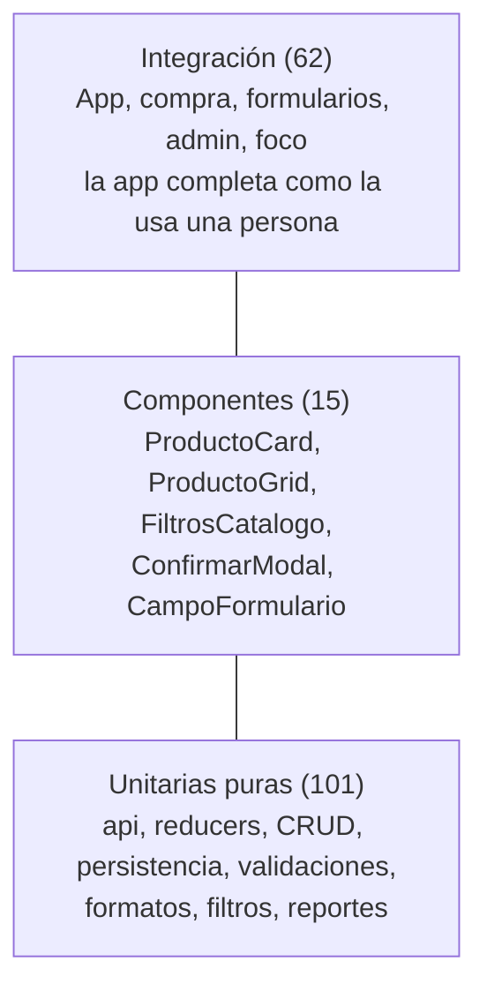
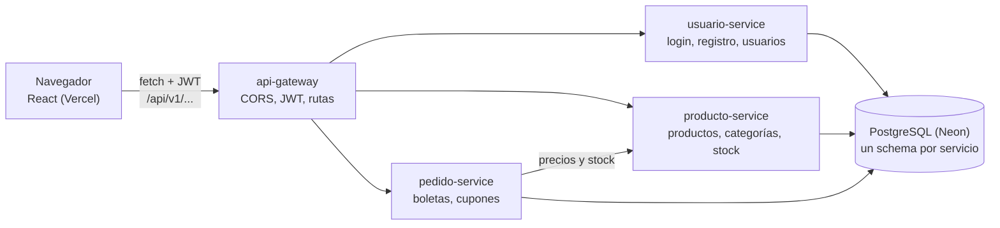

# NexusTech: documentación completa del proyecto

> **Asignatura:** Desarrollo Fullstack II · **Evaluación 2** (30 %) y **Evaluación 3** (integración con el backend)
> **Equipo:** Cristóbal Stenger y Xavier Marin
> **Repositorio:** `CristobalStenger/nexus_frontend`

Este documento explica todo el proyecto NexusTech, con tres focos:

1. **La migración** desde HTML, CSS y JavaScript "vanilla" (entrega 1) a **React + Vite** (entrega 2).
2. **Las funciones y pestañas nuevas** que pide la Evaluación 2: categorías, ofertas, checkout,
   pago exitoso y con error, y el panel de administración completo.
3. **Las pruebas unitarias**: cómo están configuradas, qué verifican y cuánto código cubren.
4. **La integración con el backend** (Evaluación 3): el frontend usa la API REST de los
   microservicios con `fetch` y JWT, en lugar de simular la base de datos en `localStorage`
   (sección 10).

---

## Índice

1. [Resumen del proyecto](#1-resumen-del-proyecto)
2. [Cómo ejecutar el proyecto](#2-cómo-ejecutar-el-proyecto)
3. [Punto de partida: la entrega 1 en HTML, CSS y JS](#3-punto-de-partida-la-entrega-1-en-html-css-y-js)
4. [La migración a React + Vite](#4-la-migración-a-react--vite)
   - [4.5 Guía de componentes de React](#45-guía-de-componentes-de-react)
5. [Funciones nuevas y pestañas](#5-funciones-nuevas-y-pestañas)
6. [Pruebas unitarias](#6-pruebas-unitarias)
7. [Verificación manual](#7-verificación-manual)
8. [Limitaciones y trabajo futuro](#8-limitaciones-y-trabajo-futuro)
9. [Preguntas frecuentes para la defensa](#9-preguntas-frecuentes-para-la-defensa)
10. [Integración con el backend (Evaluación 3)](#10-integración-con-el-backend-evaluación-3)

---

## 1. Resumen del proyecto

**NexusTech** es una tienda en línea chilena de tecnología: componentes de PC, periféricos,
consolas y notebooks. La entrega 1 era un sitio de páginas HTML estáticas con lógica en
JavaScript. En la entrega 2 se convirtió en una **aplicación de una sola página (SPA)** hecha con
React y se agregaron nuevos flujos de compra y administración. En la entrega 3 la SPA se conectó
al backend: productos, categorías, órdenes y usuarios ahora viven en PostgreSQL y se consultan
por una API REST protegida con JWT.

### Las dos entregas dentro del repositorio

| Entrega      | Carpeta                                          | Tecnologías                                               |
| ------------ | ------------------------------------------------ | --------------------------------------------------------- |
| Evaluación 1 | [`nexustech-html/`](https://github.com/CristobalStenger/nexus_frontend/tree/948ceaf472d32a08d28bb0cf4581a54355025353/nexustech-html) (commit `948ceaf`) | HTML5, CSS3, Bootstrap 5 (CDN), JavaScript |
| Evaluación 2 | [`nexustech-react/`](nexustech-react/)           | React 19, Vite 7, React Router 7, React Bootstrap, Vitest |
| Evaluación 3 | `nexustech-react/` + repositorio [`nexus_backend`](https://github.com/CristobalStenger/nexus_backend) | Lo anterior + API REST con `fetch` y JWT; backend Spring Boot y PostgreSQL |

La carpeta `nexustech-html/` de la entrega 1 se quitó de `main` para aligerar el repositorio. Se
conserva sin cambios en el commit `948ceaf`; para recuperarla en local basta con
`git checkout 948ceaf -- nexustech-html`. La versión React vive en `nexustech-react/`, igual que
el proyecto de ejemplo de la guía del curso.

### Tecnologías de la entrega 2

| Herramienta                       | Para qué se usa                                                                   |
| --------------------------------- | --------------------------------------------------------------------------------- |
| **React 19**                      | Construir la interfaz con componentes reutilizables y estado                      |
| **Vite 7**                        | Servidor de desarrollo con recarga instantánea y compilación de producción        |
| **React Router 7** (declarativo)  | Navegación entre pestañas sin recargar la página (`/productos`, `/admin`…)        |
| **React Bootstrap 2 + Bootstrap 5** | Diseño responsivo con componentes React (Navbar, Modal, Carousel, Toast, Form…) |
| **Bootstrap Icons**               | Íconos de la interfaz                                                             |
| **Context + useReducer**          | Estado global de la tienda y de la sesión                                         |
| **`fetch` + API REST** (entrega 3) | Productos, categorías, órdenes y usuarios vienen del backend (`services/api.js`)  |
| **JWT** (entrega 3)               | Token que entrega el login y se envía en cada operación protegida                 |
| **localStorage**                  | Solo el carrito, el cupón, la sesión (con su token) y los mensajes de contacto    |
| **Vitest 4 + Testing Library**    | Pruebas unitarias, de componentes y de integración                                |
| **ESLint**                        | Revisión automática de calidad del código                                         |

### Estado actual

| Comprobación              | Resultado                                         |
| ------------------------- | ------------------------------------------------- |
| Pruebas automatizadas     | **178 aprobadas** en 19 archivos                  |
| Cobertura de líneas       | **96,96 %**                                       |
| Cobertura de ramas        | **91,63 %**                                       |
| Prueba real con el backend | Aprobada (Playwright + 4 microservicios + PostgreSQL, sección 10.8) |
| ESLint                    | Sin errores ni advertencias                       |
| Compilación (`npm run build`) | Aprobada                                      |

### Cifras de la migración

| Medida                        | Entrega 1 (HTML/JS)                 | Entrega 2 (React)                                  |
| ----------------------------- | ----------------------------------- | -------------------------------------------------- |
| Páginas o vistas              | 21 archivos HTML                    | 35 páginas (16 de tienda + 19 de administración)    |
| Archivos de lógica            | 7 archivos JS (≈2.270 líneas)       | 102 módulos JS/JSX (≈6.550 líneas, incluye datos)  |
| Componentes reutilizables     | 0 (cabecera y pie copiados 21 veces) | 37 componentes + 5 hooks propios                   |
| Pruebas automatizadas         | 0                                   | 164 (≈1.800 líneas)                                |

---

## 2. Cómo ejecutar el proyecto

Requisitos: **Node.js 20.19 o superior** (comprueba con `node -v`) y el **backend encendido**
(repositorio [`nexus_backend`](https://github.com/CristobalStenger/nexus_backend), sección
"Ejecutar en local"; su API Gateway queda en `http://localhost:8080`).

```bash
cd nexustech-react
npm ci                       # instala las versiones exactas guardadas en package-lock.json
cp .env.example .env.local   # VITE_API_URL: dirección del API Gateway
npm run dev                  # abre http://localhost:5173
```

Si `VITE_API_URL` no está definida se usa `http://localhost:8080`. En Vercel se configura en
*Settings → Environment Variables* con la URL del gateway en Cloud Run.

> **En Windows (PowerShell):** si la ruta tiene espacios o paréntesis, escríbela entre comillas:
> `cd "C:\Users\...\nexus_frontend-main\nexustech-react"`.
> El comando `npm ci` debe ejecutarse **dentro** de `nexustech-react`, donde está `package-lock.json`.

| Script                  | Qué hace                                               |
| ----------------------- | ------------------------------------------------------ |
| `npm run dev`           | Servidor de desarrollo con recarga automática          |
| `npm run build`         | Compila la versión de producción en `dist/`            |
| `npm run preview`       | Sirve la compilación de `dist/`                        |
| `npm run lint`          | Revisa el código con ESLint                            |
| `npm test`              | Vitest en modo observación                             |
| `npm run test:run`      | Ejecuta las 178 pruebas una vez (no necesitan backend) |
| `npm run test:coverage` | Pruebas + reporte de cobertura (`coverage/index.html`) |

### Cuentas de prueba

| Rol           | Correo              | Contraseña   | Qué puede hacer                                     |
| ------------- | ------------------- | ------------ | --------------------------------------------------- |
| Administrador | `admin@duoc.cl`     | `admin123`   | Tienda + panel completo (crear, editar y eliminar)  |
| Vendedor      | `vendedor@duoc.cl`  | `vende123`   | Tienda + panel con solo Productos y Órdenes (lista y detalle) |
| Cliente       | `cliente@gmail.com` | `cliente123` | Solo la tienda (el checkout se completa solo)       |

Los datos viven en la base del backend. Para volver a los datos iniciales se recrea la base
(script `db/crear-schemas.sql` del backend): al arrancar, Flyway vuelve a cargar los 40
productos, 4 categorías, 3 usuarios y 5 boletas de ejemplo.

---

## 3. Punto de partida: la entrega 1 en HTML, CSS y JS

### 3.1 Estructura original

Esta carpeta ya no está en `main`; se puede ver en el commit `948ceaf`.

```
nexustech-html/
├── index.html, catalogo.html, producto.html, carrito.html, login.html,
│   nosotros.html, blogs.html, contacto.html
├── categorias/   componentes.html, perifericos.html, consolas.html, notebooks.html
├── blogs/        detalle-1.html, detalle-2.html
├── admin/        index.html, productos.html, producto-nuevo.html, producto-editar.html,
│                 usuarios.html, usuario-nuevo.html, usuario-editar.html
├── css/styles.css
└── js/           main.js, catalogo.js, detalle.js, carrito.js, validaciones.js,
                  regiones.js, admin.js
```

| Archivo JS        | Responsabilidad en la entrega 1                                           |
| ----------------- | ------------------------------------------------------------------------- |
| `catalogo.js`     | Arreglo de 40 productos, filtros y dibujo de las tarjetas con `innerHTML` |
| `main.js`         | Agregar al carrito, contador del carrito, usuario activo, cerrar sesión   |
| `detalle.js`      | Dibujar el detalle del producto guardado en `PRODUCTO_VISTO`              |
| `carrito.js`      | Tabla del carrito, cantidades, cupones y botón pagar                      |
| `validaciones.js` | Validación en vivo (RUN, correos, claves…), login, registro y contacto    |
| `regiones.js`     | Regiones y comunas de Chile para los formularios                          |
| `admin.js`        | Permisos por rol y CRUD de productos y usuarios del panel                 |

### 3.2 Limitaciones que motivaron la migración

| Problema en la entrega 1                                                                                                   | Consecuencia                                                                   |
| -------------------------------------------------------------------------------------------------------------------------- | ------------------------------------------------------------------------------ |
| La cabecera, el menú y el pie estaban **copiados en los 21 HTML**                                                          | Un cambio en el menú obligaba a editar 21 archivos                             |
| Las vistas se armaban con **cadenas de texto e `innerHTML`**                                                               | Código difícil de leer y riesgo de insertar HTML no deseado                    |
| Los eventos usaban **funciones globales** en atributos `onclick="..."`                                                     | Todo vivía en el ámbito global y dependía del orden de los `<script>`          |
| Cada función leía y escribía **`localStorage` por su cuenta**                                                              | El estado quedaba repartido y la pantalla no se actualizaba sola               |
| Para pasar datos entre páginas se guardaba un id en `localStorage` (`PRODUCTO_VISTO`, `PRODUCTO_EDITAR`) y se recargaba la página | No había URLs propias: no se podía compartir el enlace de un producto  |
| El carrito guardaba **una copia completa** de cada producto                                                                | Si el admin cambiaba un precio, el carrito seguía mostrando el anterior        |
| No había **control de stock** al agregar ni al pagar                                                                       | Se podían comprar más unidades de las disponibles                              |
| Avisos con `alert()` y `confirm()`                                                                                         | Ventanas que bloquean la página                                                |
| **Sin pruebas automatizadas**                                                                                              | Cada cambio se revisaba a mano                                                 |

---

## 4. La migración a React + Vite

### 4.1 Creación del proyecto

```bash
npm create vite@latest nexustech-react -- --template react
cd nexustech-react
npm install react-router@7 react-bootstrap@2 bootstrap@5 bootstrap-icons
npm install -D vitest@4 @vitest/coverage-v8@4 @testing-library/react \
  @testing-library/dom @testing-library/user-event @testing-library/jest-dom jsdom
```

- **Vite** entrega el servidor de desarrollo, la recarga instantánea al guardar y el comando de
  compilación. El proyecto se abre con `npm run dev`, no con Live Server.
- `index.html` tiene un único `<div id="root">`. `src/main.jsx` monta allí el componente `App`.
- Migrar **no fue copiar los HTML dentro de `src`**: cada pantalla y cada comportamiento se
  reescribió como componentes con estado.

### 4.2 Estructura nueva

```
nexustech-react/
├── index.html                 Única página HTML: <div id="root">
├── vite.config.js             Configuración de Vite y de las pruebas (Vitest)
├── public/_redirects          Regla para que el hosting sirva index.html en todas las rutas
├── vercel.json                La misma regla para Vercel (entrega 3)
├── .env.example               VITE_API_URL: dirección del API Gateway (entrega 3)
├── docs/COBERTURA_TESTING.md  Documento de cobertura de pruebas
├── src/                       Código de la aplicación
    ├── main.jsx               Monta <App /> dentro de BrowserRouter e importa los estilos
    ├── App.jsx                Providers y definición de todas las rutas
    ├── styles.css             Estilos de la entrega 1 + estilos nuevos
    ├── data/                  Datos fijos: configuración, regiones, blogs y portada
    ├── services/              api.js (REST con el backend), CRUD genérico y lo que guarda el navegador
    ├── store/                 Reducers: reglas de negocio puras
    ├── context/               Providers que comparten el estado
    ├── hooks/                 Hooks propios (useTienda, useAuth, useFormulario, useTitulo, useCambioDeRuta)
    ├── utils/                 Formatos, validaciones, filtros y reportes (funciones puras)
    ├── components/            37 componentes reutilizables agrupados por tema
    ├── pages/tienda/          16 páginas de la tienda
    └── pages/admin/           19 páginas del panel: Dashboard, Perfil y Reportes, más una carpeta
                               por sección (ordenes/, productos/, categorias/, usuarios/)
└── tests/                     Pruebas, separadas por nivel (sección 6.2)
    ├── setup.js               Limpieza antes y después de cada prueba
    ├── utilidades.jsx         renderApp, iniciarSesionComo, guardarCarrito, db, ultimoEnvio...
    ├── servidorFalso.js       Reemplaza a fetch y responde como el API Gateway (entrega 3)
    ├── datos/                 Datos iniciales del backend (productos, usuarios, órdenes, cupones)
    ├── unitarias/             Funciones puras: reducers, servicios y utils
    ├── componentes/           Un componente con props controladas
    └── integracion/           La aplicación completa recorrida como una persona
```

| Carpeta                  | Contenido                                                                                                                                 |
| ------------------------ | ----------------------------------------------------------------------------------------------------------------------------------------- |
| `data/`                  | `blogs`, `regiones`, `portada` y `configuracion` (costo de despacho, roles, íconos de categoría). Los datos iniciales de productos, usuarios y órdenes pasaron al backend y a `tests/datos/` |
| `services/api.js`        | Llamadas REST al API Gateway con `fetch`: URL `/api/v1`, token JWT y errores del backend (sección 10.3) |
| `services/storage.js`    | `leerJSON` y `guardarJSON` con `try/catch`, y los nombres de las claves                                                                   |
| `services/crud.js`       | Funciones CRUD puras sobre arreglos: `obtener`, `crear`, `actualizar`, `eliminar`                                                         |
| `services/persistencia.js` | Lo que se guarda en el navegador: carrito, cupón, sesión con su token y mensajes de contacto, validando su forma                        |
| `store/tiendaReducer.js` | Carrito, cupón y las respuestas del backend: catálogo, órdenes, boleta de la compra y CRUD de productos y categorías                      |
| `store/authReducer.js`   | Sesión (con el JWT), lista de usuarios del administrador y roles                                                                          |
| `store/aviso.js`         | `conAviso`: agrega al estado el aviso emergente; lo usan los dos reducers                                                                 |
| `context/`               | `TiendaProvider` y `AuthProvider`: hacen las llamadas a la API y despachan lo que responde el backend                                    |
| `components/layout/`     | `Header`, `Footer`, `Layout`, `AdminLayout`, `RutaProtegida`, `BuscadorHeader`, `ZonaUsuario`, `BotonCarrito`, `AccesoDenegado`, `CargaDatos` (espera los datos del backend) |
| `components/producto/`   | `ProductoCard`, `ProductoGrid`, `FiltrosCatalogo`, `PrecioProducto`, `StockBadge`, `CategoriaCard`                                        |
| `components/compra/`     | `FilaCarrito`, `TablaItemsCompra`, `ResumenCompra`, `DatosOrden`, `ResultadoCompra`                                                       |
| `components/formularios/` | `CampoFormulario`, `SelectorRegionComuna`, `UsuarioForm`, `ProductoForm`, `CategoriaForm`                                               |
| `components/admin/`      | `AdminSidebar`, `EncabezadoAdmin`, `TarjetaMetrica`, `TablaOrdenes`, `EstadoOrdenBadge`, `RolBadge`                                       |
| `components/comunes/`    | `ConfirmarModal`, `EstadoVacio`, `AvisosGlobales`, `EncabezadoPagina`                                                                     |
| `components/contenido/`  | `HeroCarousel`, `BlogCard`                                                                                                                |

### 4.3 Correspondencia entre la entrega 1 y la entrega 2

Las rutas de la columna izquierda son relativas a `nexustech-html/` (commit `948ceaf`); las de la derecha, a
`nexustech-react/src/`.

| Entrega 1 (HTML / JS)                              | Entrega 2 (React)                                                             |
| -------------------------------------------------- | ----------------------------------------------------------------------------- |
| `<header>` y `<footer>` repetidos en 21 archivos   | `components/layout/Header.jsx`, `Footer.jsx` y `Layout.jsx` (una sola vez)    |
| `index.html`                                       | `pages/tienda/Inicio.jsx` + `HeroCarousel`, `CategoriaCard`, `ProductoGrid`   |
| `catalogo.html` + `renderProductos()`              | `pages/tienda/Productos.jsx` + `FiltrosCatalogo` + `utils/catalogo.js`        |
| `categorias/*.html` (4 archivos casi iguales)      | `pages/tienda/Categorias.jsx` (una vista para todas, ruta `/categorias/:slug`) |
| `producto.html` + `detalle.js` + `PRODUCTO_VISTO`  | `pages/tienda/DetalleProducto.jsx` con la ruta `/productos/:id`               |
| `carrito.html` + `carrito.js`                      | `pages/tienda/Carrito.jsx` + `FilaCarrito` + acciones del `tiendaReducer`     |
| `login.html` (pestañas login/registro)             | `pages/tienda/Login.jsx` y `pages/tienda/Registro.jsx` (rutas separadas)      |
| `contacto.html`                                    | `pages/tienda/Contacto.jsx`                                                   |
| `blogs.html`, `blogs/detalle-1.html`, `detalle-2.html` | `pages/tienda/Blogs.jsx` y `DetalleBlog.jsx` (`/blogs/:id`) + `data/blogs.js` |
| `nosotros.html`                                    | `pages/tienda/Nosotros.jsx`                                                   |
| `js/main.js` (`agregarAlCarrito`, contador)        | Acción `AGREGAR` del reducer + `BotonCarrito`                                 |
| `js/validaciones.js` (`revisarCampo` con el DOM)   | `utils/validaciones.js` (funciones puras) + hook `useFormulario`              |
| `js/regiones.js`                                   | `data/regiones.js` + componente `SelectorRegionComuna`                        |
| `js/admin.js` (`revisarPermisos`)                  | `components/layout/RutaProtegida.jsx` + `store/authReducer.js`               |
| `admin/index.html`                                 | `pages/admin/Dashboard.jsx`                                                   |
| `admin/productos.html`, `producto-nuevo.html`, `producto-editar.html` | `ProductosAdmin`, `NuevoProducto`, `EditarProducto` + `ProductoForm` |
| `admin/usuarios.html`, `usuario-nuevo.html`, `usuario-editar.html`    | `UsuariosAdmin`, `NuevoUsuario`, `EditarUsuario` + `UsuarioForm`     |
| `css/styles.css`                                   | `src/styles.css` (mismas variables y clases + estilos nuevos)                 |
| Bootstrap por CDN + `bootstrap.bundle.min.js`      | `bootstrap` y `react-bootstrap` instalados con npm, sin el bundle de JS       |
| `alert()` y `confirm()`                            | Avisos `Toast` (`AvisosGlobales`) y `ConfirmarModal`                          |

### 4.4 Conceptos de React aplicados, con ejemplos antes y después

#### a) Plantillas repetidas → componentes y `Layout` con `Outlet`

**Antes:** cada HTML repetía unas 40 líneas de navegación y otras 12 de pie de página.

**Después:** la estructura común existe una sola vez. `Outlet` muestra la página de la ruta activa:

```jsx
// src/components/layout/Layout.jsx
export default function Layout() {
  const main = useCambioDeRuta();
  return (
    <>
      <a className="saltar-contenido" href="#contenido">Saltar al contenido</a>
      <Header />
      <AvisosGlobales />
      <main id="contenido" tabIndex={-1} ref={main} className="container my-4">
        <Outlet />
      </main>
      <Footer />
    </>
  );
}
```

#### b) `innerHTML` con cadenas de texto → JSX y `map()`

**Antes** (`js/catalogo.js`):

```js
listaAfectada.forEach(producto => {
  contenedor.innerHTML += `
    <div class="col-12 col-md-6 col-lg-3 mb-4">
      <article class="card-producto h-100 d-flex flex-column">
        ...
        <button class="btn btn-nexus w-100" onclick="agregarAlCarrito('${producto.id}')">
          Agregar al carrito
        </button>
      </article>
    </div>`;
});
```

**Después** (`src/components/producto/ProductoGrid.jsx`): cada producto es un componente y
`map()` transforma el arreglo en tarjetas. React escapa el texto, así que no se inserta HTML por
accidente.

```jsx
export default function ProductoGrid({ productos, onAgregar, mensajeVacio = '...' }) {
  if (!productos.length) return <EstadoVacio titulo={mensajeVacio} />;
  return (
    <Row className="g-4">
      {productos.map((producto) => (
        <Col xs={12} sm={6} lg={3} key={producto.id}>
          <ProductoCard producto={producto} onAgregar={onAgregar} />
        </Col>
      ))}
    </Row>
  );
}
```

#### c) Funciones globales en `onclick` → props y eventos

La tarjeta **recibe por props** el producto y la función `onAgregar`. No guarda su propio carrito:
avisa al padre para que todos compartan el mismo.

```jsx
// src/components/producto/ProductoCard.jsx (extracto)
<Button
  variant="nexus"
  disabled={agotado}
  onClick={() => onAgregar(producto.id)}
  aria-label={agotado ? `${producto.nombre} sin stock` : `Agregar ${producto.nombre} al carrito`}
>
  {agotado ? 'Sin stock' : 'Agregar al carrito'}
</Button>
```

#### d) `localStorage` disperso → reducer + Context + persistencia

**Antes** (`js/main.js`): la función leía el carrito, copiaba el producto completo, guardaba y
mostraba un `alert`. No revisaba el stock.

```js
function agregarAlCarrito(idProducto) {
  let carritoActual = JSON.parse(localStorage.getItem("CARRITO_NEXUSTECH")) || [];
  const productoEncontrado = productosNexus.find(p => p.id == idProducto);
  const existe = carritoActual.find(item => item.id == idProducto);
  if (existe) existe.cantidad += 1;
  else carritoActual.push({ ...productoEncontrado, cantidad: 1 });
  localStorage.setItem("CARRITO_NEXUSTECH", JSON.stringify(carritoActual));
  actualizarContadorCarrito();
  alert(`¡${productoEncontrado.nombre} agregado al carrito!`);
}
```

**Después** (`src/store/tiendaReducer.js`): una **función pura** calcula el estado siguiente,
valida el stock y guarda solo `{ id, cantidad }`. El precio siempre se lee del catálogo vigente.

```js
function agregar(estado, { id, cantidad = 1 }) {
  const producto = obtener(estado.productos, id);
  const item = obtener(estado.carrito, id);
  const nueva = (item?.cantidad ?? 0) + cantidad;
  if (!producto || !Number.isInteger(cantidad) || cantidad < 1 || nueva > producto.stock)
    return conAviso(estado, 'No hay más stock disponible de ese producto.', 'warning');

  const carrito = item
    ? actualizar(estado.carrito, id, { cantidad: nueva })
    : crear(estado.carrito, { id, cantidad });
  return conAviso({ ...estado, carrito }, `${producto.nombre} agregado al carrito.`);
}
```

La página solo despacha una acción: `dispatch({ type: 'AGREGAR', id })`. El `TiendaProvider`
guarda el cambio en `localStorage` con un `useEffect`, y todos los componentes que usan el
carrito (la cabecera, el carrito, el checkout) se actualizan solos.

#### e) `window.location` e ids en `localStorage` → React Router

**Antes:** `verDetalle(id)` guardaba `PRODUCTO_VISTO` en `localStorage` y recargaba la página con
`window.location.href = "producto.html"`.

**Después:** cada producto tiene su propia URL (`/productos/7`). La página lee el parámetro con
`useParams()`, y `Link` y `NavLink` cambian de vista sin recargar el documento.

```jsx
// src/App.jsx (extracto)
<Routes>
  <Route element={<Layout />}>
    <Route index element={<Inicio />} />
    <Route path="productos" element={<Productos />} />
    <Route path="productos/:id" element={<DetalleProducto />} />
    <Route path="categorias/:slug" element={<Categorias />} />
    ...
    <Route path="*" element={<NoEncontrada />} />
  </Route>
  <Route path="admin" element={<RutaProtegida roles={ROLES_PANEL} />}>
    <Route element={<AdminLayout />}>
      <Route index element={<Dashboard />} />
      ...
      <Route element={<RutaProtegida roles={SOLO_ADMIN} />}>
        <Route path="productos/nuevo" element={<NuevoProducto />} />
        ...
      </Route>
    </Route>
  </Route>
</Routes>
```

#### f) Validación que tocaba el DOM → funciones puras + `useFormulario`

**Antes:** `revisarCampo(idCampo)` buscaba el input con `document.getElementById`, decidía la
regla según el nombre del id, y pintaba las clases `is-valid` / `is-invalid` a mano.

**Después:** las reglas son **funciones puras** que reciben datos y devuelven un objeto de
errores. Se pueden probar sin abrir el navegador. Los formularios son **controlados**: el valor
de cada input viene del estado.

```js
// src/hooks/useFormulario.js (extracto)
export function useFormulario(inicial, validar) {
  const [valores, setValores] = useState(inicial);
  const [tocados, setTocados] = useState({});
  const [intentado, setIntentado] = useState(false);
  const errores = validar(valores);              // se recalculan en cada render
  const mostrar = (campo) => Boolean(tocados[campo] || intentado);
  ...
  return { valores, errores, error: (c) => (mostrar(c) ? errores[c] : undefined), cambiar, enviar, campo, ... };
}

// form.campo('correo') entrega name, value, onChange, error y valido de una vez:
<CampoFormulario {...form.campo('correo')} id="contacto-correo" etiqueta="Correo electrónico" />
```

El mismo validador (`validarUsuario`) sirve para el registro, para el administrador y para el
perfil, y el reducer lo vuelve a usar como protección aunque la vista falle.

#### g) `alert()` / `confirm()` → `Toast` y `ConfirmarModal`

Los avisos ("Producto agregado", "Cupón aplicado", "Sesión cerrada") aparecen como notificaciones
que no bloquean la página y se cierran solas. Las acciones peligrosas (vaciar el carrito, eliminar
productos, categorías o usuarios) se confirman con un `Modal` de React Bootstrap, que maneja el
foco y el teclado.

#### h) Bootstrap con CDN → React Bootstrap con npm

Se eliminó `bootstrap.bundle.min.js`. El menú colapsable, el desplegable de categorías, el
carrusel, los modales y los avisos son componentes de **React Bootstrap** controlados por estado
de React. En `main.jsx` el CSS de Bootstrap se importa **antes** que `styles.css`, para que los
estilos propios puedan sobrescribirlo.

#### i) CSS migrado

`css/styles.css` se copió a `src/styles.css` con todas sus variables (`--nexus-azul`,
`--nexus-celeste`, `--nexus-vidrio`…) y clases (`caja-vidrio`, `card-producto`, `btn-nexus`…).
Así se mantiene la identidad visual "glass" en tonos azules. Se agregaron estilos para:

- la cabecera en dos filas y el botón del carrito,
- el panel de administración (barra superior oscura, menú lateral, tarjetas de métricas),
- el precio de oferta tachado y la insignia de descuento,
- las vistas de compra exitosa y con error, y la impresión de la boleta (`@media print`),
- el enlace "Saltar al contenido" y el menú del panel en pantallas pequeñas.

React Bootstrap genera la clase `btn-<variante>`, así que los estilos propios se usan con
`<Button variant="nexus">` y `<Button variant="nexus-claro">`.

### 4.5 Guía de componentes de React

Esta es la parte nueva de la Evaluación 2, así que se explica con detalle. La aplicación tiene
**37 componentes reutilizables** en `src/components/`, **35 páginas** en `src/pages/` (que también
son componentes), **5 hooks propios** y **2 providers**.

#### a) Qué es un componente, una prop y un estado

| Concepto               | Qué es                                                                                       | Ejemplo en NexusTech                                                                     |
| ---------------------- | -------------------------------------------------------------------------------------------- | ---------------------------------------------------------------------------------------- |
| **Componente**         | Una función con nombre en mayúscula que devuelve JSX (lo que se dibuja)                      | `ProductoCard` dibuja un producto                                                        |
| **Props**              | Datos y funciones que el componente **recibe del padre**. Son de solo lectura               | `<ProductoCard producto={p} onAgregar={agregar} />`                                      |
| **Estado** (`useState`) | Datos que el componente **recuerda** y que, al cambiar, vuelven a dibujarlo                | `BuscadorHeader` recuerda el texto que escribes                                          |
| **Composición**        | Un componente usa a otros dentro de su JSX                                                   | `ProductoGrid` usa `ProductoCard`, que usa `PrecioProducto` y `StockBadge`               |
| **`children`**         | Contenido que el padre escribe entre las etiquetas del componente                            | `<ConfirmarModal>¿Seguro?</ConfirmarModal>`                                              |
| **Hook**               | Función que empieza con `use` y da a un componente poderes de React (estado, contexto, rutas) | `useState`, `useAuth`, `useNavigate`                                                     |

**Responsabilidad única (nota del PDF):** cada componente hace una sola cosa. `PrecioProducto`
solo muestra un precio, `StockBadge` solo el estado del stock, `ConfirmarModal` solo pide
confirmación. Por eso se reutilizan en la tienda y en el panel, y se prueban por separado.

#### b) Árbol de componentes

```
main.jsx
└─ BrowserRouter
   └─ App
      └─ AuthProvider                       ← estado de usuarios y sesión
         └─ TiendaProvider                  ← estado de productos, carrito y órdenes
            └─ Routes
               ├─ Layout  (rutas de la tienda)
               │  ├─ Header
               │  │  ├─ BuscadorHeader     (estado propio: texto)
               │  │  ├─ ZonaUsuario
               │  │  └─ BotonCarrito
               │  ├─ AvisosGlobales
               │  ├─ <Outlet />            ← aquí se dibuja la página de la ruta
               │  │    Inicio → HeroCarousel, CategoriaCard, ProductoGrid → ProductoCard → PrecioProducto + StockBadge
               │  │    Productos → FiltrosCatalogo + ProductoGrid
               │  │    Carrito → FilaCarrito, ResumenCompra, ConfirmarModal
               │  │    Checkout → TablaItemsCompra, CampoFormulario, SelectorRegionComuna, ResumenCompra
               │  └─ Footer
               └─ RutaProtegida → AdminLayout  (rutas de /admin)
                  ├─ AdminSidebar
                  ├─ AvisosGlobales
                  └─ <Outlet />            ← Dashboard, ProductosAdmin, UsuariosAdmin, ...
                       ProductoForm / UsuarioForm / CategoriaForm → CampoFormulario
```

#### c) Fichas de los 37 componentes

Cada ficha indica la **responsabilidad**, las **props** que recibe (las que tienen `=` traen un
valor por defecto), si tiene **estado propio** y dónde se **usa**.

**`components/layout/`: estructura de la página**

| Componente        | Responsabilidad                                                                                    | Props                            | Estado propio                              | Se usa en              |
| ----------------- | -------------------------------------------------------------------------------------------------- | -------------------------------- | ------------------------------------------ | ---------------------- |
| `Layout`          | Estructura de la tienda: enlace "saltar al contenido", cabecera, avisos, `<Outlet />` y pie        | —                                | No (usa `useCambioDeRuta` para el foco)    | `App`                  |
| `Header`          | Barra de dos filas con buscador, sesión, menú, desplegable de categorías y carrito                 | —                                | No (lee las categorías con `useTienda`)    | `Layout`               |
| `BuscadorHeader`  | Formulario de búsqueda que lleva a `/productos?q=texto`                                            | —                                | **Sí**: `texto` (input controlado)         | `Header`               |
| `ZonaUsuario`     | Muestra "Iniciar sesión / Crear cuenta" o "Hola, nombre", "Panel" y "Salir"                        | —                                | No (lee la sesión con `useAuth`)           | `Header`               |
| `BotonCarrito`    | Botón verde con el total en pesos y la insignia de unidades                                        | —                                | No (valor derivado con `resumenCarrito`)   | `Header`               |
| `Footer`          | Pie de página con enlaces                                                                          | —                                | No                                         | `Layout`               |
| `AdminLayout`     | Estructura del panel: barra oscura, menú lateral y `<Outlet />`                                    | —                                | No                                         | `App`                  |
| `RutaProtegida`   | Decide si deja pasar (`<Outlet />`), redirige al login o muestra "acceso denegado" según el rol    | `roles` (arreglo de roles)       | No                                         | `App` (anidada dos veces) |
| `AccesoDenegado`  | Mensaje cuando el rol no tiene permiso                                                             | `tipo`                           | No                                         | `RutaProtegida`        |

**`components/producto/`: catálogo**

| Componente         | Responsabilidad                                                                           | Props                                                                                       | Estado propio | Se usa en                                        |
| ------------------ | ----------------------------------------------------------------------------------------- | ------------------------------------------------------------------------------------------- | ------------- | ------------------------------------------------ |
| `ProductoCard`     | Tarjeta de un producto; avisa al padre cuando se pulsa "Agregar"                          | `producto`, `onAgregar(id)`                                                                 | No            | `ProductoGrid`                                   |
| `ProductoGrid`     | Convierte un arreglo de productos en una grilla de tarjetas, o muestra el mensaje vacío   | `productos`, `onAgregar`, `mensajeVacio = '...'`                                            | No            | Inicio, Productos, Categorías, Ofertas, Detalle  |
| `FiltrosCatalogo`  | Barra de filtros **controlada**: informa cada cambio al padre                             | `filtros`, `onCambio(campo, valor)`, `onLimpiar`, `categorias = []`, `tipos = []`, `mostrarCategoria = true`, `resultados` | No (el estado vive en el padre) | Productos, Categorías |
| `PrecioProducto`   | Precio final; con oferta agrega el precio anterior tachado y el porcentaje                | `producto`, `className = 'fs-5'`                                                            | No            | Tarjeta, Detalle, Panel (ficha y formulario)     |
| `StockBadge`       | Insignia verde, amarilla o roja según el stock                                            | `producto`                                                                                  | No            | Tarjeta, Detalle, Panel                          |
| `CategoriaCard`    | Tarjeta de una categoría con enlace a `/categorias/:slug`                                 | `categoria`, `cantidad`, `activa = false`                                                   | No            | Inicio, Categorías                               |

**`components/compra/`: carrito, checkout y boleta**

| Componente          | Responsabilidad                                                                       | Props                                                                      | Estado propio | Se usa en                              |
| ------------------- | ------------------------------------------------------------------------------------- | -------------------------------------------------------------------------- | ------------- | -------------------------------------- |
| `FilaCarrito`       | Fila del carrito con los botones `−` y `+` y eliminar; marca en rojo si el stock bajó | `item`, `onCambiar(cantidad)`, `onQuitar()`                                | No            | `Carrito`                              |
| `TablaItemsCompra`  | Tabla de solo lectura con los productos de una compra                                 | `items`                                                                    | No            | Checkout, `ResultadoCompra`            |
| `ResumenCompra`     | Subtotal, descuento del cupón, envío y total                                          | `subtotal`, `descuento = 0`, `envio`, `total`, `cupon`, `textoTotal = 'TOTAL'` | No        | Carrito, Checkout, `ResultadoCompra`   |
| `DatosOrden`        | Datos del cliente y de la entrega de una orden, en campos de solo lectura             | `orden`                                                                    | No            | `ResultadoCompra`                      |
| `ResultadoCompra`   | Estructura común de "compra exitosa", "pago con error" y boleta del panel             | `orden`, `icono`, `claseIcono`, `titulo`, `etiquetaTitulo = 'h1'` (`h2` en la boleta del panel, que ya tiene su h1), `subtitulo`, `acciones`, `children` | No         | CompraExitosa, CompraError, DetalleOrden |

**`components/formularios/`: formularios**

| Componente             | Responsabilidad                                                                                 | Props                                                                                         | Estado propio                                  | Se usa en                                 |
| ---------------------- | ----------------------------------------------------------------------------------------------- | --------------------------------------------------------------------------------------------- | ---------------------------------------------- | ----------------------------------------- |
| `CampoFormulario`      | Campo con etiqueta, ayuda, borde de error o éxito y mensaje enlazado con `aria-describedby`     | `id`, `etiqueta`, `ayuda`, `error`, `valido`, `as` (`input`, `textarea` o `select`), `className`, y el resto pasa al input | No | Todos los formularios        |
| `SelectorRegionComuna` | Dos listas dependientes: al cambiar la región se reinicia la comuna                             | `prefijo`, `region`, `comuna`, `errores`, `validos` (marca en verde), `onCambio`, `disabled`   | No                                             | `UsuarioForm`, Checkout                   |
| `UsuarioForm`          | Formulario de usuario con tres modos: `registro`, `admin` y `perfil`                            | `inicial`, `usuarios`, `runOriginal`, `modo = 'admin'`, `textoBoton`, `onGuardar`, `onCancelar` | Sí, mediante `useFormulario`                | Registro, Nuevo y Editar usuario, Perfil  |
| `ProductoForm`         | Crear (producto `null`) o editar un producto, con vista previa del precio                       | `producto = null`, `productos`, `categorias`, `onGuardar`, `onCancelar`                       | Sí, mediante `useFormulario`                   | Nuevo y Editar producto                   |
| `CategoriaForm`        | Crear o editar una categoría; muestra la dirección (slug) que se generará                       | `categoria = null`, `categorias`, `onGuardar`, `onCancelar`                                   | Sí, mediante `useFormulario`                   | Nueva y Editar categoría                  |

**`components/admin/`: panel de administración**

| Componente         | Responsabilidad                                                                  | Props                                                    | Estado propio | Se usa en                                             |
| ------------------ | -------------------------------------------------------------------------------- | -------------------------------------------------------- | ------------- | ----------------------------------------------------- |
| `AdminSidebar`     | Menú lateral; oculta Usuarios y Reportes al Vendedor y trae "Cerrar sesión"      | —                                                        | No            | `AdminLayout`                                         |
| `EncabezadoAdmin`  | Título de cada vista del panel con botones de acción opcionales                  | `titulo`, `children`, `acciones`                         | No            | Todas las páginas del panel                           |
| `TarjetaMetrica`   | Tarjeta de color con una cifra (compras, productos, usuarios…)                   | `titulo`, `valor`, `detalle`, `icono`, `variante = 'primary'` | No       | Dashboard, Reportes, Historial                        |
| `TablaOrdenes`     | Tabla de órdenes con enlace a la boleta                                          | `ordenes`                                                | No            | Dashboard, Órdenes, Historial de compras              |
| `EstadoOrdenBadge` | Insignia "Pagada" o "Rechazada"                                                  | `estado`                                                 | No            | `TablaOrdenes`, Detalle de orden                      |
| `RolBadge`         | Insignia de color según el rol                                                   | `tipo`                                                   | No            | Usuarios, Ficha de usuario, Perfil                    |

**`components/comunes/` y `components/contenido/`: piezas genéricas**

| Componente         | Responsabilidad                                                                                  | Props                                                                                | Estado propio | Se usa en                                          |
| ------------------ | ------------------------------------------------------------------------------------------------ | ------------------------------------------------------------------------------------ | ------------- | -------------------------------------------------- |
| `ConfirmarModal`   | Modal de confirmación: se abre con una prop y avisa con `onConfirmar` o `onCancelar`                 | `abierto`, `titulo`, `children`, `textoConfirmar = 'Confirmar'`, `variante = 'danger'`, `onConfirmar` (sin ella solo muestra Cancelar), `onCancelar` | No (lo abre el padre) | Carrito, listados del panel |
| `EstadoVacio`      | Mensaje con ícono cuando una lista no tiene elementos                                            | `icono = 'bi-search'`, `titulo`, `esPagina = false` (su título pasa a ser el h1), `children` | No            | `ProductoGrid`, Carrito, páginas "no existe"       |
| `EncabezadoPagina` | Caja de título de las páginas de la tienda                                                       | `icono`, `titulo`, `children`                                                        | No            | Páginas de la tienda                               |
| `AvisosGlobales`   | Notificaciones `Toast` (reemplazan los `alert()`) y aviso si no se pudo guardar en el navegador  | —                                                                                    | No (lee los avisos del estado global) | `Layout`, `AdminLayout`    |
| `HeroCarousel`     | Carrusel de portada con las diapositivas de `data/portada.js`                                    | `diapositivas`                                                                       | No            | `Inicio`                                           |
| `BlogCard`         | Tarjeta de un artículo con enlace a `/blogs/:id`                                                 | `blog`                                                                               | No            | `Blogs`                                            |

Solo **`BuscadorHeader`** guarda estado directamente y los tres formularios lo guardan a través
de `useFormulario`. El resto son componentes **de presentación**: reciben datos por props y los
muestran, sin estado propio. Eso los hace simples de entender, de reutilizar y de probar.

#### d) Estado: dónde vive cada dato

| Tipo de dato                                              | Dónde vive                               | Ejemplos                                                                                   |
| --------------------------------------------------------- | ---------------------------------------- | ------------------------------------------------------------------------------------------ |
| Lo comparten varias pantallas                             | **Context + `useReducer`** (global)      | Productos, categorías, órdenes, carrito, cupón (`TiendaProvider`); usuarios y sesión (`AuthProvider`) |
| Lo comparten todas las personas                           | **Backend (PostgreSQL)**, vía `api.js`   | Productos, categorías, órdenes y usuarios: se piden al cargar y se cambian con POST, PUT y DELETE |
| Solo afecta a una pantalla                                | **`useState`** en la página              | Filtros del catálogo, cupón escrito en el carrito, modal abierto, texto de búsqueda en las tablas, "boleta enviada" |
| Valores y errores de un formulario                        | **`useFormulario`** (hook propio)        | Login, registro, contacto, checkout y formularios del panel                                |
| Debe poder compartirse o recargarse                       | **La URL**                               | `/productos/7` (parámetro `:id`), `/productos?q=ryzen` (parámetro de búsqueda)             |
| Debe sobrevivir al cerrar la página en este navegador     | **`localStorage`** (vía `persistencia.js`) | Carrito, cupón y sesión (con su token JWT)                                              |
| Se puede calcular a partir de otro dato                   | **No se guarda: se calcula**             | Total del carrito, unidades, precio con descuento, estado del stock, métricas del dashboard |

**Patrones usados**

- **Levantar el estado ("lifting state up"):** `FiltrosCatalogo` no guarda los filtros; los recibe
  del padre (`Productos`) y le avisa con `onCambio`. Así el padre filtra los productos con el mismo valor.
- **Componente controlado:** el valor de cada `<input>` viene del estado y `onChange` lo actualiza.
- **Reiniciar estado con `key`:** `<FichaProducto key={producto.id}>` y `<ProductoForm key={producto.id}>`
  hacen que React cree el componente de cero al cambiar de producto, y se reinicia la cantidad o el formulario.
- **Renderizado condicional:** `ConfirmarModal` aparece solo con `abierto`, `PrecioProducto` tacha el
  precio solo si hay oferta y `RutaProtegida` decide qué mostrar según la sesión.
- **Valores por defecto en props:** `ProductoGrid` usa `mensajeVacio = '...'` si el padre no envía uno.
- **Composición con `children`:** `ConfirmarModal`, `EstadoVacio`, `EncabezadoAdmin` y `ResultadoCompra`
  dejan que el padre decida el contenido interno.
- **Polimorfismo con `as`:** `CampoFormulario` puede ser un `input`, un `textarea` o un `select`
  sin repetir la etiqueta ni el manejo de errores.
- **Un solo formulario para crear y editar:** `ProductoForm` recibe `producto = null` para crear
  o un objeto para editar, y `UsuarioForm` cambia con la prop `modo`.

**Ejemplo completo: el recorrido de "Agregar al carrito"**

```jsx
// 1) Página (Productos.jsx): lee el estado global y entrega una función al hijo
const { estado, dispatch } = useTienda();
<ProductoGrid productos={visibles} onAgregar={(id) => dispatch({ type: 'AGREGAR', id })} />

// 2) ProductoGrid: recorre el arreglo y pasa las props a cada tarjeta
{productos.map((producto) => (
  <Col key={producto.id}><ProductoCard producto={producto} onAgregar={onAgregar} /></Col>
))}

// 3) ProductoCard: el clic llama a la función recibida por props
<Button disabled={agotado} onClick={() => onAgregar(producto.id)}>Agregar al carrito</Button>

// 4) tiendaReducer: valida el stock y devuelve el estado nuevo
// 5) TiendaProvider: guarda en localStorage; BotonCarrito (en el Header) muestra el nuevo total
```

`ProductoCard` no sabe qué es un carrito: solo avisa que se pulsó el botón. La regla del stock
vive en el reducer, y el contador de la cabecera se actualiza solo porque lee el mismo estado.

#### e) Hooks propios y providers

| Hook o provider       | Archivo                              | Qué entrega o hace                                                                                                 |
| --------------------- | ------------------------------------ | ------------------------------------------------------------------------------------------------------------------ |
| `useTienda()`         | `hooks/useTienda.js`                 | `estado`, `dispatch` (carrito) y las funciones que llaman al backend: `guardarProducto`, `eliminarProducto`, `guardarCategoria`, `eliminarCategoria`, `aplicarCupon`, `pagar`. Falla con un mensaje claro si se usa fuera de `TiendaProvider` |
| `useAuth()`           | `hooks/useAuth.js`                   | `usuarios`, `sesion` y las funciones `ingresar`, `registrar`, `guardarUsuario`, `eliminarUsuario`, `cerrarSesion` (todas asíncronas, devuelven `{ ok }`) |
| `useFormulario()`     | `hooks/useFormulario.js`             | `valores`, `errores`, `error(campo)`, `valido(campo)`, `cambiar`, `actualizar`, `enviar`, `reiniciar`. Muestra un error solo si el campo fue tocado o se intentó enviar |
| `useTitulo(titulo)`   | `hooks/useTitulo.js`                 | Cambia el título de la pestaña del navegador en cada página                                                        |
| `useCambioDeRuta()`   | `hooks/useCambioDeRuta.js`             | Al cambiar de página sube al inicio y mueve el foco al contenido principal (accesibilidad). Al abrir la app no lo mueve, para que el primer Tab llegue a "Saltar al contenido" |
| `TiendaProvider`      | `context/TiendaProvider.jsx`         | Pide el catálogo (y las órdenes si el rol entra al panel), llama a producto-service y pedido-service y despacha cada respuesta. Guarda el carrito con `useEffect` |
| `AuthProvider`        | `context/AuthProvider.jsx`           | Login y registro contra usuario-service, guarda la sesión con su token y, para el administrador, carga los usuarios |
| `contextos.js`        | `context/contextos.js`               | Crea `TiendaContext` y `AuthContext` en un archivo sin componentes, para que Vite recargue sin perder el estado    |

**Regla de los hooks:** solo se llaman en el nivel superior de un componente o de otro hook,
nunca dentro de `if` ni de bucles. ESLint (`eslint-plugin-react-hooks`) lo revisa automáticamente.

#### f) Las páginas también son componentes

Cada ruta de `App.jsx` apunta a una **página** (`Inicio`, `Carrito`, `Dashboard`…). Una página
actúa como **contenedor**: lee el estado global con `useTienda` o `useAuth`, mantiene su estado
local y reparte datos a los componentes de presentación. Por ejemplo, `Productos` guarda los
filtros con `useState`, calcula la lista visible con `filtrarProductos` y se la entrega a
`FiltrosCatalogo` y `ProductoGrid`.

### 4.6 Flujo de datos



1. Al abrir la app, `TiendaProvider` pide productos y categorías; si la sesión es del panel,
   también las órdenes, y `AuthProvider` pide los usuarios al administrador.
2. Mientras llegan, `CargaDatos` muestra "Conectando con NexusTech…" (o el error con "Reintentar").
3. Las páginas leen el estado con `useTienda()` o `useAuth()`.
4. Para cambiar datos llaman a una función del provider (`guardarProducto`, `pagar`…), que envía
   la petición con el token y, si el backend acepta, despacha su respuesta al reducer.
5. El carrito se maneja en el navegador con `dispatch` y un `useEffect` lo guarda en `localStorage`.

### 4.7 Persistencia en el navegador

Desde la entrega 3, lo que comparten todas las personas (productos, categorías, órdenes y
usuarios) lo guarda el backend en PostgreSQL. En `localStorage` quedan solo estas claves:

| Clave                  | Contenido                                                     |
| ---------------------- | ------------------------------------------------------------- |
| `USUARIO_ACTIVO`       | Sesión abierta con su **token JWT**, **sin la contraseña**    |
| `CARRITO_NEXUSTECH`    | Carrito normalizado: solo `{ id, cantidad }`                  |
| `CUPON_NEXUSTECH`      | Cupón aplicado (el backend lo vuelve a validar al pagar)      |
| `MENSAJES_NEXUSTECH`   | Mensajes del formulario de contacto (no tiene backend)        |

Al cargar, `persistencia.js`:

- limpia del carrito las cantidades inválidas y las filas repetidas; los productos que ya no
  existen se quitan cuando llega el catálogo del backend;
- descarta cupones mal formados y sesiones sin token o con el token vencido;
- si el navegador rechaza la escritura (por ejemplo, almacenamiento lleno), muestra un aviso y la
  tienda sigue funcionando mientras la página esté abierta.

### 4.8 Reglas de negocio conservadas de la entrega 1

- Correos solo `@duoc.cl`, `@profesor.duoc.cl` y `@gmail.com`.
- Contraseña de 4 a 10 caracteres.
- RUN sin puntos ni guion, de 7 a 9 caracteres y con dígito verificador (módulo 11).
- Largos máximos: nombre 50 o 100, apellidos 100, dirección 300, comentario y descripción 500.
- Un precio 0 se muestra como **FREE**.
- Stock crítico por producto, marcado en rojo en el panel.
- Código de producto único.
- Cupones `FELIZ18` (10 %), `CUTURRUFO70` (25 %), `BOOTSTRAP` (5 %) y `XAVICRIS` (15 %).
- Roles Administrador, Vendedor (solo productos y órdenes, en lectura) y Cliente. Nadie puede eliminar su propia cuenta.

Desde la entrega 3 el backend vuelve a validar todas estas reglas: los formularios avisan antes
de enviar y el servidor tiene la última palabra (por ejemplo, un código de producto repetido
que otra persona creó mientras tanto).

---

## 5. Funciones nuevas y pestañas

### 5.1 Mapa de navegación

Corresponde a la Figura 2 del PDF. **Tienda** (pública):



**Administrador** (`/admin`, requiere sesión de Administrador o Vendedor):



### 5.2 Pestañas de la tienda

Leyenda: 🆕 vista nueva de la entrega 2 · ♻️ vista migrada y mejorada.

| Ruta                       | Vista                | Estado | Qué hace                                                                                                                                             |
| -------------------------- | -------------------- | ------ | ---------------------------------------------------------------------------------------------------------------------------------------------------- |
| `/`                        | Inicio               | ♻️     | Carrusel de 3 diapositivas, tarjetas de categorías, 4 ofertas destacadas, 8 productos destacados y beneficios                                         |
| `/productos`               | Catálogo             | ♻️     | Búsqueda sin importar tildes (nombre, tipo o código), filtros por categoría, tipo, rango de precio y stock, 4 órdenes, contador y botón limpiar       |
| `/productos/:id`           | Detalle de producto  | ♻️     | Precio con oferta, estado del stock, selector de cantidad que no supera el disponible, unidades ya en el carrito y productos relacionados             |
| `/categorias`              | Categorías           | 🆕     | Tarjetas con la cantidad de productos de cada categoría y una sección por categoría con 4 productos                                                   |
| `/categorias/:slug`        | Categoría            | 🆕     | Productos de una categoría con sus propios filtros. Reemplaza los 4 HTML de `categorias/`                                                            |
| `/ofertas`                 | Ofertas              | 🆕     | Productos con descuento, ordenados del mayor al menor, con el precio anterior tachado                                                               |
| `/nosotros`                | Nosotros             | ♻️     | Empresa, misión, visión y equipo de desarrollo                                                                                                      |
| `/blogs` y `/blogs/:id`    | Blog                 | ♻️     | Listado y detalle de artículos, generados desde `data/blogs.js`                                                                                     |
| `/contacto`                | Contacto             | ♻️     | Validación en vivo, contador de caracteres y mensajes guardados. Con sesión iniciada, el nombre y el correo se completan solos                        |
| `/login`                   | Iniciar sesión       | ♻️     | Validación de formato, mensaje de credenciales incorrectas y vuelta a la página que se quería abrir                                                 |
| `/registro`                | Registro             | ♻️     | RUN, fecha, nombre, apellidos, correo, contraseña repetida, región y comuna dependientes, dirección y términos. Al terminar lleva al login            |
| `/carrito`                 | Carrito              | ♻️     | Cantidades con límite de stock, eliminar, vaciar con confirmación, cupones y aviso si el stock cambió (bloquea la compra)                            |
| `/checkout`                | Checkout             | 🆕     | Datos del cliente, dirección de entrega, opción de entrega, tarjeta simulada y resumen con el total                                                 |
| `/compra/exitosa/:numero`  | Pago correcto        | 🆕     | Número y código de orden, datos, productos, total pagado, imprimir boleta y envío simulado por correo                                               |
| `/compra/error/:numero`    | Pago con error       | 🆕     | Motivo del rechazo, datos, productos y botón "Volver a realizar el pago"                                                                            |
| `*`                        | Página no encontrada | 🆕     | Mensaje y enlace de vuelta al inicio                                                                                                                |

#### Cabecera nueva (propuesta del PDF)

La barra superior tiene dos filas. Arriba están el logo, el buscador y los botones de sesión;
abajo, el menú y el carrito:

- **Buscador:** envía el texto al catálogo como `?q=...`, así funciona desde cualquier página.
- **Sesión:** muestra "Iniciar sesión" y "Crear cuenta", o "Hola, nombre", "Panel" (solo para
  Administrador y Vendedor) y "Salir".
- **Menú:** Inicio, Productos, **Categorías** (desplegable generado desde las categorías
  guardadas), Ofertas, Nosotros, Blog y Contacto. `NavLink` marca la pestaña activa.
- **Botón del carrito:** muestra el total en pesos y una insignia con las unidades.
- En el celular todo se agrupa en un menú colapsable.

#### Checkout y pago simulado



- **Cliente:** nombre, apellidos y correo. Si hay sesión iniciada se completan solos, como pide
  la nota del PDF.
- **Dirección de entrega:** calle, departamento (opcional), región, comuna e indicaciones (opcional).
- **Opción de entrega:** despacho a domicilio por $3.990 o retiro en tienda gratis. El total se
  recalcula al instante.
- **Pago:** número de tarjeta de 16 dígitos, titular, vencimiento `MM/AA` vigente y CVV de 3 o 4 dígitos.
- **Reglas del rechazo**, en la función pura `evaluarPago`:
  1. algún producto del carrito ya no tiene stock suficiente, o
  2. la tarjeta termina en `0000` (tarjeta de prueba rechazada).
- Cada intento queda registrado como una **orden** con número correlativo (desde la 1001), un
  código `ORD-AAAAMMDD-número`, los datos del cliente y de la entrega, una copia de los productos
  con su precio en ese momento, el cupón, el subtotal, el descuento, el envío, el total, el estado
  (`pagada` o `rechazada`) y el motivo del rechazo.
- Si el pago se aprueba, el stock se descuenta y el carrito se vacía. Si se rechaza, la orden
  queda registrada pero no se toca ni el stock ni el carrito.

### 5.3 Panel de administración

El panel tiene su propia estructura (`AdminLayout`): una barra superior oscura con el nombre y el
rol del usuario, un menú lateral y el contenido. Está protegido por `RutaProtegida`:

| Situación                                   | Resultado                                                          |
| ------------------------------------------- | ------------------------------------------------------------------ |
| Sin sesión                                  | Redirige a `/login` y, al entrar, vuelve a la página pedida        |
| Cliente                                     | "Acceso denegado"                                                  |
| Vendedor                                    | Solo ve Productos y Órdenes (lista y detalle), sin botones para crear, editar ni eliminar; al entrar a `/admin` va directo a Productos |
| Vendedor que escribe a mano cualquier otra ruta del panel | "Acceso denegado"                                    |
| Administrador                               | Acceso total                                                       |

| Ruta                                | Vista                        | Acceso        | Qué hace                                                                                                                |
| ----------------------------------- | ---------------------------- | ------------- | ----------------------------------------------------------------------------------------------------------------------- |
| `/admin`                            | Dashboard 🆕                 | Admin         | 4 métricas (compras y ventas, productos e inventario, usuarios, stock crítico), accesos a los módulos y últimas órdenes |
| `/admin/ordenes`                    | Órdenes / boletas 🆕         | Admin, Vendedor | Listado con búsqueda y filtro por estado                                                                              |
| `/admin/ordenes/:numero`            | Mostrar boleta 🆕            | Admin, Vendedor | Detalle completo de la orden, motivo si fue rechazada y botón imprimir                                                |
| `/admin/productos`                  | Listado de productos ♻️      | Admin, Vendedor | Tabla con búsqueda, filas críticas en rojo, descuento visible y acciones                                              |
| `/admin/productos/:id`              | Mostrar producto 🆕          | Admin, Vendedor | Ficha con todos los datos y las unidades vendidas                                                                     |
| `/admin/productos/nuevo`            | Nuevo producto ♻️            | Admin         | Formulario con validación en vivo y vista previa del precio con descuento                                              |
| `/admin/productos/:id/editar`       | Editar producto ♻️           | Admin         | Mismo formulario precargado; el id se conserva                                                                         |
| `/admin/productos/criticos`         | Productos críticos 🆕        | Admin         | Productos con stock menor o igual al crítico y acceso para reponer                                                    |
| `/admin/productos/reportes`         | Reporte de productos 🆕      | Admin         | Inventario valorizado por categoría, productos sin stock, en oferta y más vendidos                                    |
| `/admin/categorias`                 | Categorías 🆕                | Admin         | Listado con la cantidad de productos de cada una                                                                      |
| `/admin/categorias/nueva`           | Nueva categoría 🆕           | Admin         | Nombre, descripción e ícono; la dirección (slug) se genera sola                                                       |
| `/admin/categorias/:id/editar`      | Editar categoría 🆕          | Admin         | Al renombrarla se actualizan sus productos                                                                            |
| `/admin/usuarios`                   | Usuarios ♻️                  | Admin         | Búsqueda, filtro por rol y acciones                                                                                   |
| `/admin/usuarios/nuevo`             | Nuevo usuario ♻️             | Admin         | Crea cuentas de cualquiera de los 3 roles                                                                             |
| `/admin/usuarios/:run`              | Mostrar usuario 🆕           | Admin         | Ficha del usuario y resumen de sus compras                                                                            |
| `/admin/usuarios/:run/editar`       | Editar usuario ♻️            | Admin         | La cuenta propia se edita desde Perfil, sin cambiar el RUN ni el rol                                                  |
| `/admin/usuarios/:run/compras`      | Historial de compras 🆕      | Admin         | Órdenes del usuario (por RUN o correo), total gastado y pagos rechazados                                              |
| `/admin/reportes`                   | Reportes 🆕                  | Admin         | Ventas totales, ticket promedio, unidades, % de pagos aprobados, ventas por categoría y por día, tipo de entrega       |
| `/admin/perfil`                     | Perfil 🆕                    | Admin         | La persona edita sus datos; el RUN y el rol no se cambian desde aquí                                                  |

**Reglas del CRUD** (el formulario las revisa antes de enviar y el backend las vuelve a validar):

- **Productos:** código único, precio entero ≥ 0, stock entero ≥ 0, descuento de 0 a 90 % y URL
  de imagen `http`/`https`. Al eliminar un producto, también sale del carrito.
- **Categorías:** nombre único sin importar tildes, mayúsculas ni signos, para que la dirección
  `/categorias/...` no se repita, y con al menos una letra o un número. Al renombrarla se actualizan sus productos.
  Una categoría con productos no se puede eliminar.
- **Usuarios:** RUN y correo únicos. Si un usuario edita su propia cuenta, la sesión se actualiza.
  No se puede eliminar la cuenta que está en uso ni cambiar el rol propio: así siempre queda un administrador.

### 5.4 Otras mejoras

- **Datos de ejemplo** (desde la entrega 3 los carga el backend con Flyway): 5 órdenes iniciales, para que el dashboard y los reportes tengan
  información desde el primer uso; un vendedor y un cliente de prueba; y 10 productos con
  descuento para la vista de ofertas.
- **Accesibilidad:** enlace "Saltar al contenido", etiquetas asociadas a cada campo, errores
  vinculados con `aria-describedby`, botones con nombres descriptivos ("Agregar Mouse al
  carrito"), `aria-current` en la pestaña activa, foco en el contenido al cambiar de página y
  título de la pestaña por vista.
- **Diseño responsivo:** grillas de Bootstrap en todas las vistas, menú colapsable y menú del
  panel en filas en pantallas pequeñas. Se revisó a 390 px y a 1280 px.
- **Publicación:** `public/_redirects` hace que el hosting sirva `index.html` en cualquier ruta,
  así se puede recargar `/productos/7` sin error 404. En Vercel cumple la misma función `vercel.json`.

---

## 6. Pruebas unitarias

### 6.1 Herramientas y configuración

| Herramienta                    | Rol                                                                                   |
| ------------------------------ | ------------------------------------------------------------------------------------- |
| **Vitest 4**                   | Ejecuta las pruebas (`describe`, `it`, `expect`) y mide la cobertura con `v8`         |
| **jsdom**                      | Simula el navegador: `document`, `localStorage` y eventos                             |
| **@testing-library/react**     | Renderiza componentes y los busca como lo haría una persona (por rol, texto o etiqueta) |
| **@testing-library/user-event** | Simula escritura, clics y selección en listas                                        |
| **@testing-library/jest-dom**  | Comprobaciones legibles: `toBeInTheDocument`, `toBeDisabled`, `toHaveValue`…          |

> El PDF propone Jasmine + Karma. Se eligió **Vitest + Testing Library**, el stack de la guía del
> curso, porque se integra con Vite sin configuración extra y Karma está descontinuado. La
> sintaxis es la misma de Jasmine (`describe`, `it`, `expect`) y se cubren las cuatro categorías
> pedidas: renderizado, props, estado y eventos.

**`vite.config.js`**: el mismo archivo configura Vite y las pruebas.

```js
export default defineConfig({
  plugins: [react()],
  test: {
    environment: 'jsdom',
    setupFiles: ['./tests/setup.js'],
    include: ['tests/**/*.test.{js,jsx}'],
    coverage: {
      provider: 'v8',
      reporter: ['text', 'html', 'json-summary'],
      include: ['src/**/*.{js,jsx}'],
      exclude: ['src/main.jsx', 'src/data/**'],
    },
  },
});
```

**`tests/setup.js`**: cada prueba empieza limpia, así ninguna depende de otra.

```js
beforeEach(() => {
  localStorage.clear();
  window.scrollTo = vi.fn();   // jsdom no implementa scrollTo ni print
  window.print = vi.fn();
});
afterEach(() => {
  cleanup();                   // desmonta lo renderizado
  localStorage.clear();
  vi.restoreAllMocks();        // restaura los espías
});
```

**`tests/utilidades.jsx`**: funciones de apoyo como `renderApp(ruta)` (toda la app con
`MemoryRouter`, esperando a que lleguen los datos del backend), `iniciarSesionComo('Administrador')`
(deja una sesión con token), `guardarCarrito([...])`, `db()` (los datos del servidor falso) y
`ultimoEnvio('POST', '/boletas')` (el JSON que envió el frontend).

**`tests/servidorFalso.js`** (entrega 3): antes de cada prueba reemplaza a `fetch` por un servidor
en memoria con las mismas rutas `/api/v1`, JSON, códigos HTTP y mensajes que el API Gateway, y
con los mismos datos iniciales que carga el backend (`tests/datos/`). Así las pruebas recorren la
integración completa sin encender los microservicios (sección 10.8).

### 6.2 Tres niveles de prueba



1. **Funciones puras (101 pruebas):** las reglas de negocio se prueban sin renderizar nada. Son
   rápidas y precisas: una entrada y el resultado esperado.
2. **Componentes (15 pruebas):** cada componente se renderiza por separado con props controladas.
3. **Integración (62 pruebas):** se monta la aplicación completa y se recorre como lo haría una
   persona: escribir, hacer clic, navegar y revisar lo que se ve, lo que se envía al backend y lo
   que queda guardado en él (servidor falso).

Todas siguen el patrón **Preparar → Actuar → Comprobar**.

### 6.3 Las categorías del PDF, con ejemplos reales

#### Renderizado correcto: una lista muestra todos sus elementos

```jsx
// tests/componentes/ProductoGrid.test.jsx
it('renderiza una tarjeta por cada elemento del arreglo', () => {
  render(<MemoryRouter><ProductoGrid productos={productosIniciales} onAgregar={vi.fn()} /></MemoryRouter>);
  expect(screen.getAllByRole('article')).toHaveLength(40);
});
```

#### Renderizado condicional: el error aparece solo cuando hay error

```jsx
// tests/componentes/CampoFormulario.test.jsx
it('muestra el mensaje de error solo cuando recibe uno', () => {
  render(<CampoFormulario id="campo-run" etiqueta="RUN" value="1" onChange={() => {}} error="RUN inválido" />);
  const campo = screen.getByLabelText('RUN');
  expect(campo).toHaveClass('is-invalid');
  expect(campo).toHaveAttribute('aria-describedby', 'error-campo-run');
});
```

Otros casos: el modal no existe mientras está cerrado; el precio tachado aparece solo con oferta;
"Credenciales incorrectas" aparece solo después de un intento fallido.

#### Props: un botón recibe su etiqueta y su función `onClick`

```jsx
// tests/componentes/ProductoCard.test.jsx
it('llama a la función onClick recibida con el id del producto', async () => {
  const onAgregar = vi.fn();
  mostrar({ onAgregar });
  await userEvent.click(screen.getByRole('button', { name: 'Agregar Mouse Gamer al carrito' }));
  expect(onAgregar).toHaveBeenCalledTimes(1);
  expect(onAgregar).toHaveBeenCalledWith(7);
});
```

#### Estado: el formulario cambia cuando el usuario escribe

```jsx
// tests/integracion/formularios.test.jsx
it('el estado del formulario cambia cuando el usuario escribe', async () => {
  const user = userEvent.setup();
  renderApp('/login');
  const correo = screen.getByLabelText('Correo electrónico');
  await user.type(correo, 'admin@duoc.cl');
  expect(correo).toHaveValue('admin@duoc.cl');
});
```

#### Eventos: un clic cambia el estado o ejecuta una función

```jsx
// tests/integracion/compra.test.jsx (extracto)
await user.click(screen.getByRole('button', { name: 'Agregar una unidad de AMD Ryzen 5 7600X' }));
expect(screen.getByLabelText('Cantidad de AMD Ryzen 5 7600X')).toHaveTextContent('2');
expect(screen.getByRole('link', { name: 'Carrito (2)' })).toHaveTextContent('$499.980');
```

#### Lógica de negocio sin interfaz: el reducer es una función pura

```js
// tests/unitarias/tiendaReducer.test.js
it('rechazada: registra la orden pero conserva carrito, cupón y stock', () => {
  const inicial = iniciar({ carrito: [{ id: 1, cantidad: 2 }], cupon: { codigo: 'FELIZ18', descuento: 10 } });
  const final = tiendaReducer(inicial, { type: 'COMPRA', orden: orden('rechazada') });
  expect(final.ordenes).toHaveLength(1);
  expect(final.carrito).toEqual(inicial.carrito);
  expect(final.productos[0].stock).toBe(2);
});
```

### 6.4 Inventario de pruebas

| Archivo                                      | Nivel       | Pruebas | Qué verifica                                                                         |
| -------------------------------------------- | ----------- | ------: | ------------------------------------------------------------------------------------ |
| `tests/unitarias/validaciones.test.js`       | Unitaria    |      25 | RUN, correos, registro, contraseña opcional al editar, contacto, producto, categoría, checkout y tarjeta |
| `tests/unitarias/formatos.test.js`           | Unitaria    |      11 | CLP, FREE, descuentos, normalización, slugs, fechas y estados de stock               |
| `tests/unitarias/catalogo.test.js`           | Unitaria    |       8 | Filtros combinados y los 4 órdenes del catálogo                                      |
| `tests/unitarias/reportes.test.js`           | Unitaria    |       6 | Ventas, categorías, días, más vendidos, inventario e historial                       |
| `tests/unitarias/crud.test.js`               | Unitaria    |       2 | CRUD sin mutar el arreglo original                                                   |
| `tests/unitarias/api.test.js`                | Unitaria    |      10 | URL `/api/v1`, JSON y token, 204, errores del backend, 401/403, 5xx, sin conexión y adaptadores |
| `tests/unitarias/persistencia.test.js`       | Unitaria    |       9 | Carrito y cupón en el navegador, sesión con token vigente y sin contraseña, mensajes |
| `tests/unitarias/tiendaReducer.test.js`      | Unitaria    |      22 | Carrito, cupón, totales, catálogo y órdenes del backend, boleta pagada y rechazada, CRUD |
| `tests/unitarias/authReducer.test.js`        | Unitaria    |       8 | Sesión con JWT, sesión vencida, roles, lista de usuarios, perfil propio              |
| `tests/componentes/ProductoCard.test.jsx`    | Componente  |       6 | Props, clic, botón deshabilitado, precio con oferta y FREE                           |
| `tests/componentes/ProductoGrid.test.jsx`    | Componente  |       2 | Renderizado de listas y estado vacío                                                 |
| `tests/componentes/FiltrosCatalogo.test.jsx` | Componente  |       2 | Componente controlado que informa sus cambios                                        |
| `tests/componentes/ConfirmarModal.test.jsx`  | Componente  |       2 | Abierto/cerrado, confirmar y cancelar                                                |
| `tests/componentes/CampoFormulario.test.jsx` | Componente  |       3 | Etiqueta, error accesible y variante select                                          |
| `tests/integracion/App.test.jsx`             | Integración |      23 | Navegación, catálogo, rutas por rol, vista del vendedor, token vencido o rechazado, servidor caído |
| `tests/integracion/formularios.test.jsx`     | Integración |       7 | Login (401 del backend), registro (409 si el correo existe) y contacto              |
| `tests/integracion/compra.test.jsx`          | Integración |      15 | Carrito, cupón validado en el backend, checkout, boleta pagada y rechazada, servidor caído |
| `tests/integracion/admin.test.jsx`           | Integración |      16 | Dashboard, boletas, reportes, CRUD de productos, categorías y usuarios contra la API, perfil |
| `tests/integracion/foco.test.jsx`            | Integración |       1 | El foco no se mueve al abrir la app y pasa al contenido al navegar                   |
| **Total**                                    |             | **178** |                                                                                      |

<details>
<summary><strong>Pruebas nuevas o reescritas para la integración (clic para desplegar)</strong></summary>

**`tests/unitarias/api.test.js`** (10, nuevo)
- Arma la URL versionada y envía JSON con el token · un GET sin sesión no envía cuerpo ni token · 204 devuelve null · convierte los errores del backend (ProblemDetail) en `ErrorApi` · con errores de validación muestra el mensaje de cada campo · 401 y 403 sin cuerpo tienen un mensaje claro · un 5xx sin detalle (servicio despertando) pide intentar de nuevo · sin conexión responde con estado 0
- Adaptadores: las líneas de la boleta usan `id` como el carrito · una fecha de nacimiento null queda como texto vacío

**`tests/unitarias/persistencia.test.js`** (9)
- Lee la alternativa si la clave no existe o el JSON está corrupto · guarda, borra con null e informa si el navegador rechaza la escritura
- Guarda y recupera el carrito con su cupón · limpia cantidades inválidas, filas repetidas y cupones mal formados · sin productos en el carrito no conserva el cupón
- La sesión guarda el token y nunca la contraseña · sabe si un token sigue vigente · solo restaura una sesión bien formada y con el token vigente · acumula los mensajes de contacto

**`tests/unitarias/tiendaReducer.test.js`** (22)
- Carrito: acumula cantidades sin duplicar ni mutar · respeta el stock · impide productos inexistentes y cantidades inválidas (5) · cambia cantidades y retira el cupón al quedar vacío · quita un producto y vacía el carrito · calcula subtotal, cupón y envío · aplica el cupón que validó el backend y lo quita
- Datos del backend: el catálogo llega y se quitan del carrito los productos que ya no existen · sin carrito se descarta el cupón · las órdenes del panel se cargan y se olvidan al salir · guarda el error de carga
- Boleta de pedido-service: pagada (registra, vacía el carrito y refleja el stock) · rechazada (conserva carrito, cupón y stock)
- CRUD con la respuesta del backend: agrega y reemplaza productos · al eliminar un producto lo saca del carrito · al renombrar una categoría actualiza sus productos · crea y elimina categorías · avisos y acciones desconocidas

**`tests/unitarias/authReducer.test.js`** (8)
- Guarda la sesión que entrega el backend y la cierra (sin dejar usuarios en memoria) · una sesión vencida se cierra con su propio aviso · distingue los permisos de cada rol
- Carga la lista de usuarios · agrega y actualiza por id · al editar la cuenta propia actualiza la sesión y conserva el token · elimina por id · avisos

**`tests/integracion/App.test.jsx`** (23): además de la navegación y el catálogo de la entrega 2:
- El vendedor solo ve Productos y Órdenes, sin acciones de escritura (menú: solo Órdenes y Productos) · ve el detalle de productos y órdenes · ve "Acceso denegado" en nuevo producto, categorías, perfil, usuarios y productos críticos (5)
- No restaura una sesión con el token vencido · si el backend rechaza el token cierra la sesión y lo avisa · si el servidor no responde lo avisa y permite reintentar

**`tests/integracion/compra.test.jsx`** (15)
- Carrito: agrega, cambia cantidades y elimina · se conserva al volver a montar · descarta los productos que ya no existen en el backend · valida los cupones en el backend · vacía tras confirmar · bloquea la compra si el stock cambió
- Checkout: envía solo el carrito y el cupón y el backend calcula la boleta · sin productos no hay formulario · valida antes de llamar al backend · autocompleta con la sesión · compra exitosa (stock descontado en el backend y RUN tomado del token) · pago rechazado y reintento · stock insuficiente · servidor caído: avisa y deja reintentar · resultados redirigen según el estado y las órdenes no son públicas

**`tests/integracion/admin.test.jsx`** (16)
- Dashboard, boletas, reportes y críticos con los datos de pedido-service
- Productos: crea (envía `categoriaId`), muestra y edita · rechaza código repetido · elimina y lo saca del carrito · si el backend rechaza el cambio muestra su mensaje · busca · Cancelar vuelve a la ficha
- Categorías: crea, renombra y no elimina una con productos
- Usuarios: crea, edita sin cambiar la contraseña y elimina · protege la propia cuenta · historial · perfil en `/usuarios/me` · cerrar sesión borra el token

</details>

### 6.5 Cobertura

Resultado de `npm run test:coverage`. Se mide solo `src/` (las pruebas viven en `tests/`) y
se excluyen `main.jsx` y los datos iniciales (`src/data`).

| Métrica    | Cobertura   | Detalle     |
| ---------- | ----------: | ----------- |
| Sentencias | **96,08 %** | 1155 / 1202 |
| Ramas      | **91,63 %** | 800 / 873   |
| Funciones  | **95,68 %** | 421 / 440   |
| Líneas     | **96,96 %** | 1024 / 1056 |

| Carpeta                                   | Líneas cubiertas |
| ----------------------------------------- | ---------------: |
| `services/` (api, CRUD y persistencia)    | 100 %            |
| `store/` (reducers)                       | 100 %            |
| `utils/` (validaciones, formatos…)        | 99,1 %           |
| `components/`                             | 90–100 %         |
| `pages/tienda/`                           | 96,9 %           |
| `context/` (llamadas a la API)            | 93,4 %           |
| `pages/admin/`                            | 92,2 %           |

**Análisis:**

- **La lógica de negocio está cubierta casi al 100 %.** Los reducers, servicios y utilidades
  concentran las reglas (stock, cupones, pago y validaciones) y se prueban como funciones puras.
- **Lo que queda sin cubrir** son, sobre todo, ramas defensivas: abrir una página de edición con
  un id que no existe, cerrar a mano un aviso emergente, los errores de los hooks usados fuera
  de su provider y algunos errores del backend poco probables (por ejemplo, que falle la carga de
  usuarios del administrador). No contienen reglas de negocio.
- **Lo que las pruebas no garantizan:** jsdom no dibuja estilos, por eso el diseño responsivo se
  revisó a mano en el navegador (sección 7). Las imágenes externas de los productos no se cargan
  durante las pruebas.
- **Cobertura no es ausencia de errores:** mide qué código se ejecutó. Por eso las pruebas revisan
  comportamientos visibles (textos, botones, valores guardados) y no detalles internos.

El reporte HTML queda en `nexustech-react/coverage/index.html` y muestra línea por línea qué se
ejecutó. El documento de cobertura para la entrega está en
[`nexustech-react/docs/COBERTURA_TESTING.md`](nexustech-react/docs/COBERTURA_TESTING.md).

---

## 7. Verificación manual

Además de las pruebas automatizadas, la aplicación se recorrió en **Chromium** a **390 px**
(celular) y **1280 px** (escritorio), sin errores en la consola:

1. Agregar productos desde el catálogo y aplicar el cupón `FELIZ18` en el carrito.
2. Intentar pagar con el formulario vacío: aparecen todos los errores.
3. Pagar con la tarjeta `4242 4242 4242 0000`: vista "No se pudo realizar el pago" y el carrito intacto.
4. "Volver a realizar el pago" con `4242 4242 4242 4242`: vista "Se ha realizado la compra" y el stock descontado.
5. Entrar a `/admin` sin sesión: redirige al login; con `admin@duoc.cl` vuelve al dashboard.
6. Recorrer las 17 vistas del panel: dashboard, órdenes, boleta, productos, ficha, nuevo,
   editar, críticos, reporte de productos, categorías, nueva categoría, usuarios, ficha de
   usuario, editar usuario, historial, reportes y perfil.
7. Revisar el menú colapsable de la tienda y el panel en el celular.

En la entrega 3 se repitió el recorrido **contra el backend real** (4 microservicios + PostgreSQL)
con un script de Playwright: catálogo desde producto-service, cupón inexistente y `FELIZ18`,
compra sin sesión (boleta creada por pedido-service con el mismo total que mostraba el
checkout), login del administrador con JWT, crear y eliminar un producto, editar un usuario sin
escribir su contraseña, menú del vendedor (solo Órdenes y Productos, con "Acceso denegado"
en categorías) y login con clave incorrecta. Todo sin errores en la consola (sección 10.8).

---

## 8. Limitaciones y trabajo futuro

| Estado                                                                                              | Detalle                                                                          |
| --------------------------------------------------------------------------------------------------- | -------------------------------------------------------------------------------- |
| ✅ **Resuelto en la entrega 3:** login, roles y datos en el navegador                                | Autenticación con JWT en usuario-service, autorización por rol en cada microservicio y datos compartidos en PostgreSQL |
| Pago simulado con reglas fijas (tarjetas terminadas en `0000` rechazadas)                           | Pasarela de pago real (Webpay, Mercado Pago…)                                    |
| El envío de la boleta por correo es simulado                                                        | Servicio de correo desde el backend                                              |
| El token se guarda en `localStorage` (un script malicioso en la página podría leerlo)               | Cookie `HttpOnly` y protección CSRF                                              |
| La página de resultado de una compra solo existe durante la visita (las órdenes no son públicas)    | Endpoint para que el cliente vea sus propias boletas                             |
| Imágenes de productos enlazadas desde sitios externos                                              | Imágenes propias en un almacenamiento de archivos                                |

---

## 9. Preguntas frecuentes para la defensa

**¿Por qué el carrito guarda solo `{ id, cantidad }` y no el producto completo?**
Para tener una sola fuente de verdad. El nombre, el precio y la imagen se leen del catálogo
vigente, así un cambio de precio en el panel se refleja de inmediato en el carrito.

**¿Por qué el stock se descuenta al pagar y no al agregar al carrito?**
Porque agregar no es comprar. Al pagar se valida que todo el carrito siga disponible: si un
producto quedó sin stock, el pago completo se rechaza y no se descuenta nada.

**¿Qué diferencia hay entre el estado local y el estado global?**
Los filtros del catálogo o un modal abierto solo afectan a una pantalla: usan `useState`. Los
productos, el carrito y la sesión los necesitan varias pantallas: viven en Context con `useReducer`.

**¿Por qué los reducers son funciones puras?**
Porque reciben un estado y una acción y devuelven un estado nuevo, sin tocar el DOM ni
`localStorage`. Eso permite probarlos sin renderizar nada (más de 30 pruebas lo hacen) y evita
efectos inesperados.

**¿Para qué sirve la prop `key` en `map()`?**
Permite que React identifique cada elemento de forma estable y actualice solo lo que cambió.
Se usa el `id` del producto, nunca la posición en el arreglo.

**¿Dónde debe validarse la autorización en un sistema real?**
En el backend, y desde la entrega 3 así funciona: React decide qué pantalla mostrar
(`RutaProtegida`, menú del vendedor), pero cada microservicio revisa el rol del token JWT y
responde 403 si no corresponde. Cambiar `localStorage` a mano no da más permisos: el token está
firmado por el servidor.

**¿Cómo viaja la sesión entre el frontend y el backend?**
`POST /api/v1/auth/login` devuelve `{ token, usuario }`. El frontend guarda la sesión con el
token y lo envía como `Authorization: Bearer <token>` en cada operación protegida. Si el token
vence o el servidor lo rechaza (401), la sesión se cierra con un aviso.

**¿Por qué el frontend no envía los precios al pagar?**
Porque se podrían alterar en el navegador. Solo envía los ids y cantidades del carrito, el cupón
y los datos del formulario; pedido-service consulta los precios y el stock en producto-service y
calcula la boleta. El resumen del checkout usa las mismas fórmulas, por eso coinciden.

**¿Cómo se prueban las llamadas sin encender el backend?**
Con `tests/servidorFalso.js`, que reemplaza a `fetch` y responde como el API Gateway. Las pruebas
revisan qué JSON se envió (`ultimoEnvio`) y qué quedó guardado (`db()`). Además, se hizo una prueba
real con Playwright contra los microservicios.

**¿Por qué un `Link` se comporta distinto que un `<a href>` externo?**
`Link` cambia la URL con el historial del navegador y React Router muestra otra vista sin
recargar el documento. Un enlace externo carga una página nueva desde el servidor.

**¿Por qué pasar las pruebas en jsdom no garantiza que el diseño se vea bien?**
jsdom simula el DOM pero no dibuja CSS. El diseño responsivo se revisa en un navegador real.

**¿Qué significa el principio de "responsabilidad única" en este proyecto?**
Cada componente hace una sola cosa: `ProductoCard` muestra un producto, `PrecioProducto` solo
el precio, `StockBadge` solo el estado del stock y `ConfirmarModal` solo pide confirmación.
Por eso se reutilizan en la tienda y en el panel, y se prueban por separado.

---

## 10. Integración con el backend (Evaluación 3)

En la Evaluación 3 el frontend dejó de simular la base de datos en `localStorage`. Ahora consume
la API REST del backend NexusTech (repositorio
[`nexus_backend`](https://github.com/CristobalStenger/nexus_backend)): 4 microservicios en Spring
Boot con PostgreSQL y seguridad JWT. Allí están documentados el modelo de datos, cada endpoint
y Swagger.

### 10.1 Arquitectura



### 10.2 Configuración

| Qué                     | Dónde                                    | Valor                                                       |
| ----------------------- | ---------------------------------------- | ----------------------------------------------------------- |
| Dirección del gateway   | `VITE_API_URL` (`.env.local` o Vercel)   | Local: `http://localhost:8080` (es el valor por defecto)    |
| Orígenes permitidos     | `FRONTEND_URL` en el api-gateway         | Local: `http://localhost:5173`; en la nube, el dominio de Vercel |
| Proyecto en Vercel      | *Root Directory*                         | `nexustech-react` (Vite se detecta solo)                    |
| Rutas de la SPA         | `vercel.json` y `public/_redirects`      | Toda ruta responde `index.html`                             |
| Cabeceras de seguridad  | `vercel.json`                            | `X-Content-Type-Options`, `X-Frame-Options` y `Referrer-Policy` |

`VITE_API_URL` se lee al compilar: si cambia la URL del gateway, hay que volver a desplegar.

### 10.3 Cómo se llama a la API: `src/services/api.js`

```js
// Arma la URL versionada, envía JSON y el token, y convierte los errores del backend
const producto = await api('/productos', { metodo: 'POST', datos, token });
```

- **URL:** `${VITE_API_URL}/api/v1${ruta}`.
- **Encabezados:** `Content-Type: application/json` si hay cuerpo y `Authorization: Bearer <token>` si hay sesión.
- **Errores:** si la respuesta no es 2xx lanza `ErrorApi` con el `status` y el mensaje del
  backend (`detail` o el mensaje de cada campo en `errores`). 401 y 403 sin cuerpo tienen un
  mensaje propio, un 5xx sin detalle (por ejemplo, el gateway mientras un servicio despierta) pide
  intentar de nuevo, y sin conexión el `status` es 0.
- **Adaptadores:** `aOrden` (cada línea de la boleta trae `productoId`; las vistas usan `id`) y
  `aUsuario` (una fecha de nacimiento `null` pasa a texto vacío para el formulario).

### 10.4 Qué endpoint usa cada pantalla

| Pantalla o momento                    | Método y ruta                                     | Quién puede          | Servicio         |
| ------------------------------------- | ------------------------------------------------- | -------------------- | ---------------- |
| Al abrir la app (tienda y panel)      | `GET /productos` · `GET /categorias`              | Público              | producto-service |
| Panel: dashboard, órdenes, reportes   | `GET /boletas`                                    | Administrador, Vendedor | pedido-service |
| Panel: usuarios y dashboard           | `GET /usuarios`                                   | Administrador        | usuario-service  |
| Login                                 | `POST /auth/login`                                | Público              | usuario-service  |
| Registro                              | `POST /auth/registro`                             | Público              | usuario-service  |
| Carrito: aplicar cupón                | `GET /cupones/{codigo}`                           | Público              | pedido-service   |
| Checkout: pagar                       | `POST /boletas`                                   | Público (con o sin sesión) | pedido-service |
| Nuevo / editar / eliminar producto    | `POST /productos` · `PUT` y `DELETE /productos/{id}` | Administrador     | producto-service |
| Nueva / editar / eliminar categoría   | `POST /categorias` · `PUT` y `DELETE /categorias/{id}` | Administrador   | producto-service |
| Nuevo / editar / eliminar usuario     | `POST /usuarios` · `PUT` y `DELETE /usuarios/{id}` | Administrador       | usuario-service  |
| Mi perfil                             | `PUT /usuarios/me`                                | Con sesión           | usuario-service  |

Ejemplo de lo que envía el checkout. El frontend no envía precios: el backend los consulta.

```json
{
  "cliente": { "nombre": "Pedro", "apellidos": "Soto Fuentes", "correo": "cliente@gmail.com" },
  "entrega": { "tipo": "despacho", "calle": "Los Crisantemos 789", "departamento": "",
               "region": "Región Metropolitana", "comuna": "Providencia", "indicaciones": "" },
  "items": [{ "productoId": 1, "cantidad": 2 }],
  "cupon": "FELIZ18",
  "pago": { "numeroTarjeta": "4242 4242 4242 4242", "titular": "Pedro Soto", "vencimiento": "12/30", "cvv": "123" }
}
```

### 10.5 Sesión y JWT

1. `ingresar()` llama a `POST /auth/login` y guarda en `USUARIO_ACTIVO` los datos del usuario
   junto con el **token** (nunca la contraseña).
2. Cada operación protegida envía `Authorization: Bearer <token>`.
3. Al abrir la app solo se restaura una sesión cuyo token siga vigente (se lee su campo `exp`).
4. Si el backend responde 401 con una sesión abierta (token vencido o inválido), la sesión se
   cierra y aparece el aviso "Tu sesión expiró. Inicia sesión nuevamente."
5. Al cerrar sesión se borran el token y los datos del panel que había en memoria.

### 10.6 Qué cambió en el estado

- **Los providers hacen las llamadas** y despachan lo que responde el backend. Los reducers
  siguen siendo funciones puras: ya no inventan ids ni calculan el pago, solo aplican la
  respuesta (`CATALOGO`, `ORDENES`, `COMPRA`, `PRODUCTO_GUARDADO`, `USUARIO_GUARDADO`…).
- **Las funciones devuelven `{ ok }`:** la página navega solo si el backend aceptó el cambio; si
  no, se muestra su mensaje en un aviso (por ejemplo, "Ya existe un producto con ese código.").
- **Pantalla de carga:** `CargaDatos` espera el catálogo (y las órdenes o usuarios si el rol los
  necesita). Si el servidor no responde, muestra el error y un botón "Reintentar". En la nube la
  primera carga puede tardar unos segundos mientras los servicios despiertan.
- **Pago:** el botón se deshabilita mientras pedido-service responde, para no enviar la misma
  compra dos veces. Con la boleta pagada, el carrito se vacía y el stock local se descuenta con
  las mismas cantidades que descontó el backend.
- **Contraseña al editar:** el backend nunca devuelve contraseñas. Al editar un usuario o el
  perfil, dejarla vacía mantiene la actual.

### 10.7 Lo que ve cada rol (requisito de la pauta)

| Rol           | Panel                                                                                          | Backend                                   |
| ------------- | ---------------------------------------------------------------------------------------------- | ----------------------------------------- |
| Administrador | Todo: dashboard, órdenes, productos, categorías, usuarios, reportes y perfil                   | Acceso total                              |
| Vendedor      | Solo **Productos** y **Órdenes** (lista y detalle). Al entrar a `/admin` va directo a Productos; cualquier otra ruta del panel muestra "Acceso denegado" | `GET` de productos y boletas; lo demás, 403 |
| Cliente       | No entra al panel: solo la tienda                                                              | Comprar, registrarse y su perfil          |

### 10.8 Pruebas de la integración

- **Automáticas (sin backend):** `tests/servidorFalso.js` responde como el gateway con los mismos
  datos iniciales del backend. Las pruebas revisan lo que envía el frontend, cómo muestra las
  respuestas y los errores (400, 401, 403, 404, 409 y sin conexión), la sesión vencida, el
  servidor caído y la vista del vendedor. `tests/unitarias/api.test.js` prueba `api.js` por separado.
- **Real (con backend):** con los 4 microservicios y PostgreSQL encendidos, un script de
  Playwright recorrió la tienda y el panel. Llamadas observadas: `GET /productos`,
  `GET /categorias`, `GET /cupones/{codigo}`, `POST /boletas`, `POST /auth/login`, `GET /boletas`,
  `GET /usuarios`, `POST /productos`, `DELETE /productos/{id}` y `PUT /usuarios/{id}`. Todos los
  pasos pasaron y la consola quedó sin errores.

### 10.9 Ejecutar todo en local

1. Backend: crear la base con `db/crear-schemas.sql`, completar el `.env` de cada servicio y
   levantar usuario, producto, pedido y gateway (`./mvnw spring-boot:run`). Ver el README de `nexus_backend`.
2. Frontend: `cp .env.example .env.local` y `npm run dev`.
3. Abrir `http://localhost:5173` y entrar con las cuentas de prueba de la sección 2.
